# Guía del dueño — PrediGol Admin Console

Versión del 5 de octubre de 2026 (backend `5021d04`, frontend `f482844`, esquema `0064`). Todas las capturas son reales,
tomadas en la consola local tras las reparaciones de hoy, con datos reales y una cuenta de QA (nunca la tuya).

> **Lo primero que hay que saber.** PrediGol está en **modo investigación / shadow**: el sistema calcula pronósticos y
> "picks", los liquida como si se hubieran apostado y mide si tenían ventaja, pero **nadie los ve y no se apuesta
> nada**. La publicación está desactivada por una restricción de la base de datos, no por un interruptor de la web. Hoy
> ningún modelo supera al mercado (ver `PICKS_DECISION_2026-10-05.md`). La consola sirve para vigilar que los datos
> sean verdad, que el sistema funcione 24/7 y que la investigación sea honesta.

## Índice

1. [Cómo moverse](#cómo-moverse) · 2. [Rutina diaria de 5 minutos](#rutina-diaria-de-5-minutos)
3. Operaciones: [Resumen](#resumen) · [Picks (investigación)](#picks-investigación) · [Rendimiento](#rendimiento) ·
   [Explorador de cuotas](#explorador-de-cuotas)
4. Inteligencia: [Modelos](#modelos) · [Backtesting](#backtesting) · [Analítica](#analítica) ·
   [IA e investigación](#ia-e-investigación) · [Evolución](#evolución)
5. Fútbol: [Competiciones](#competiciones) · [Equipos](#equipos) · [Jugadores](#jugadores) · [Rankings](#rankings)
6. Sistema: [Verdad de datos](#verdad-de-datos) · [Calidad de datos](#calidad-de-datos) · [Sistema](#sistema) ·
   [Migración](#migración) · [Usuarios](#usuarios) · [Auditoría](#auditoría) · [Ajustes](#ajustes)
7. [La cuota de API-Football](#la-cuota-de-api-football) · 8. [Glosario](#glosario) ·
   9. [Qué hacer si…](#qué-hacer-si)

---

## Cómo moverse

* **Entrar**: `http://127.0.0.1:5173` con tu cuenta SUPER_ADMIN. La consola está en `/admin`; los usuarios normales
  nunca la ven (el menú y la API la bloquean por rol).
* **Barra superior**: `DATOS REALES` (no hay datos de demostración), `MODO INVESTIGACIÓN` (shadow), *Último dato* (hora
  del último payload recibido del proveedor), **Ver como USER** (la web tal como la ve un usuario, sin salir de tu
  sesión) y **ES / EN** (idioma; se guarda en tu perfil).
* **Horas**: siempre en UTC en la consola (los usuarios ven su zona horaria).
* **Números**: formato español (15.576; 5,5 %). Un "—" significa "no hay dato", nunca cero.

## Rutina diaria de 5 minutos

| # | Dónde | Qué mirar | Bien | Mal → qué hacer |
|---|---|---|---|---|
| 1 | Resumen → Salud del sistema | 4 componentes | todos **OK** | ver [Qué hacer si…](#qué-hacer-si) |
| 2 | Calidad de datos → tarjetas | *Ejecuciones atascadas*, *Tareas fallidas (24 h)*, *Errores del proveedor (24 h)* | 0 · 0 · pocos | mirar la pestaña *Incidencias* |
| 3 | Sistema → API-Football hoy | peticiones de hoy | < 15.000 en un día normal | revisar qué tarea gasta (Sistema → Errores / Ejecuciones) |
| 4 | Verdad de datos | *Hallazgos críticos y altos* | 0 propios (los del proveedor se aceptan o se siguen) | leer la entrada E-XXX |
| 5 | Rendimiento | ROI **con su intervalo** | intervalo que contiene el 0 = no hay nada que celebrar ni que temer | — |

---

## Resumen

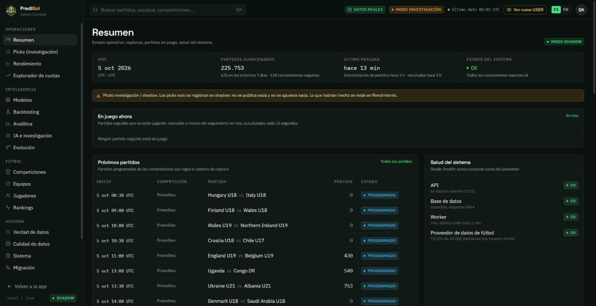
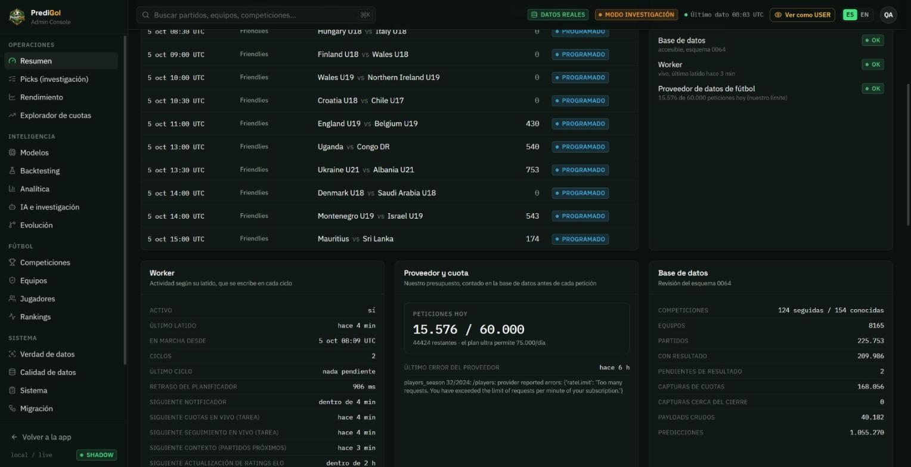

**Qué estoy viendo.** El estado de hoy en una pantalla: partidos guardados, último payload, estado del sistema, el aviso
de modo shadow, los partidos en juego, los próximos partidos con cuántos precios se han capturado, la **Salud del
sistema** (API, base de datos, worker, proveedor) y, más abajo, el worker, la cuota del proveedor y la base de datos.

**Para qué sirve.** Saber en 10 segundos si el sistema está vivo y capturando.

**Qué números vigilar.** *Salud del sistema* (cuatro OK); *Último latido* del worker (minutos); *Peticiones hoy*;
*Pendientes de resultado* (partidos empezados hace > 3 h sin resultado).

**Qué es normal.** Worker "vivo, último latido hace 0–5 min"; *Último ciclo: nada pendiente* entre ventanas de captura;
precios = 0 en partidos que el proveedor no cotiza (amistosos juveniles, por ejemplo); 1–3 pendientes de resultado que
el proveedor aún no ha cerrado.

**Qué requiere acción.** Cualquier componente en DEGRADED/DOWN durante más de 15 min; worker sin latido > 10 min;
*Pendientes de resultado* creciendo durante horas.

**Qué NO interpretar mal.** "Último error del proveedor hace 6 h" no es un problema actual: es el último error
registrado (aquí, el límite por minuto de la madrugada del 5 oct, ya corregido). "Siguiente … hace 4 min" significa
que tocaba en el último latido; la tarea ya corrió.

## Picks (investigación)

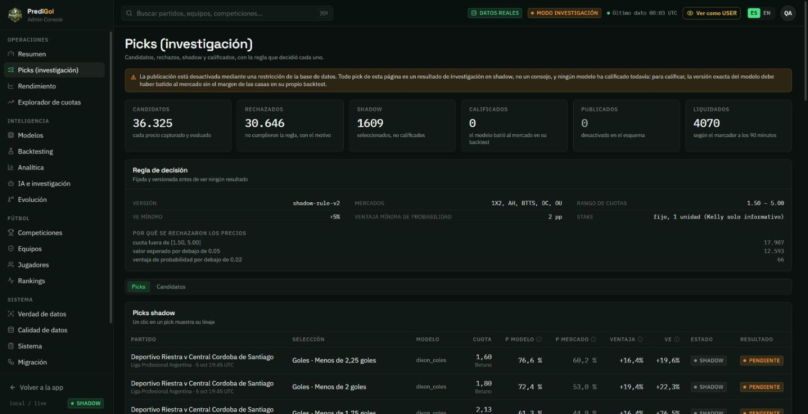

**Qué estoy viendo.** Cada precio capturado y evaluado por la **regla de decisión** versionada (`shadow-rule-v2`:
mercados 1X2, AH, BTTS, DC, OU; cuotas 1,50–5,00; VE ≥ 5 %; ventaja ≥ 2 puntos; stake fijo de 1 unidad). Candidatos,
rechazados (con el motivo), shadow (seleccionados, no calificados), **calificados (0)**, **publicados (0)** y
liquidados. Un clic en un pick muestra su linaje: precio, casa, hora de captura, modelo, versión, regla.

**Para qué sirve.** Auditar que la regla se aplica igual a todo y que cada pick es trazable.

**Qué números vigilar.** *Calificados* y *Publicados* deben seguir en **0** mientras no haya un modelo que gane al
mercado; los motivos de rechazo (la mayoría: cuota fuera de rango y VE insuficiente).

**Qué es normal.** Miles de candidatos y rechazos al día; picks "PENDIENTE" hasta que termina el partido.

**Qué requiere acción.** *Publicados* > 0 (imposible por la base de datos: avisa); picks sin linaje.

**Qué NO interpretar mal.** Un pick con "VE +89,8 %" **no** es una oportunidad: es el modelo exagerando (su VE
prometido medio fue +29 %; frente al mercado sin margen, −4,6 %). "Shadow" no es "recomendado".

## Rendimiento

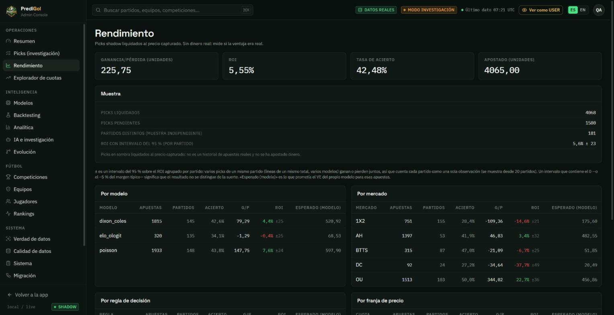

**Qué estoy viendo.** Los picks shadow liquidados al precio capturado: ganancia en unidades, ROI, tasa de acierto, y
el desglose por modelo, mercado, regla y franja de cuota. Cada ROI lleva **± su intervalo del 95 % agrupado por
partido** (varios picks de un mismo partido ganan o pierden juntos) y la columna *Esperado (modelo)*.

**Para qué sirve.** Medir si la "ventaja" era real. No es un historial de apuestas: no se ha apostado dinero.

**Qué números vigilar.** El **intervalo**, no el ROI. Hoy: ROI +5,6 % ± 23 sobre 181 partidos.

**Qué es normal.** Intervalos enormes con pocas semanas de datos; mercados que suben y bajan de una semana a otra.

**Qué requiere acción.** Nada en esta página obliga a actuar: es evidencia para la investigación.

**Qué NO interpretar mal.** **Un ROI alto en una muestra pequeña no prueba nada.** OU +22,7 % ± 36 es compatible con
perder. Si el intervalo contiene el 0 (y el −5 % del margen típico), el resultado no se distingue de la suerte.

## Explorador de cuotas

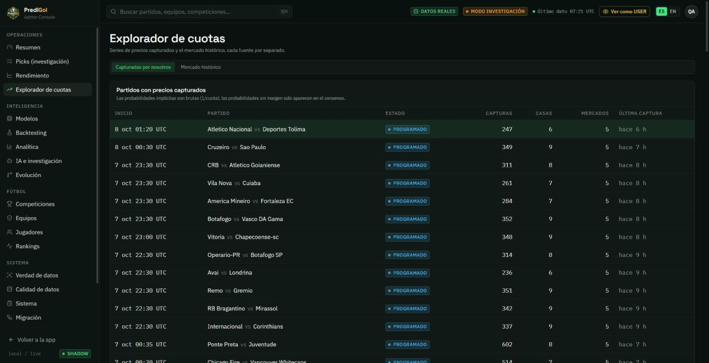

**Qué estoy viendo.** Los partidos con precios capturados por nosotros (capturas, casas, mercados, última captura) y,
en la otra pestaña, el mercado histórico (football-data.co.uk) — cada fuente por separado.

**Para qué sirve.** Comprobar que la captura funciona para un partido concreto y ver su serie de precios.

**Qué es normal.** 6–9 casas y 5 mercados por partido cotizado; capturas en las ventanas T-72 h, -48, -24, -12, -6 y
-3 h (más la lectura final tras el inicio).

**Qué requiere acción.** Un partido cotizado por el proveedor sin capturas después de pasar una ventana (aparece en
Calidad de datos como *Precios atrasados*).

**Qué NO interpretar mal.** Las probabilidades implícitas de esta tabla son brutas (1/cuota, con margen); las
probabilidades "justas" están solo en el consenso.

## Modelos

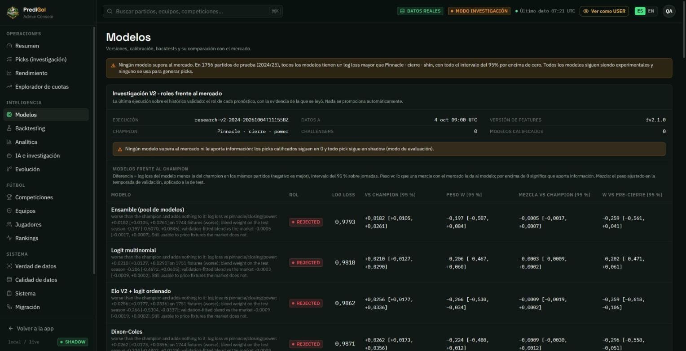

**Qué estoy viendo.** La última **Investigación V2** guardada (4 oct, sobre las 5 grandes ligas): el *champion* (el
mejor pronóstico, hoy **el mercado**: Pinnacle al cierre sin margen), los *challengers* (0), los *modelos calificados*
(0) y cada modelo frente al champion: log loss, diferencia con su intervalo, peso en una mezcla con el mercado y rol
(CHAMPION, CHALLENGER, RESEARCH, REJECTED).

**Para qué sirve.** Saber si algún modelo aporta algo frente al mercado. Es la página que decide si podría haber picks.

**Qué números vigilar.** La columna *vs champion*: un modelo útil tendría el intervalo **entero por debajo de 0**; el
*Peso w*: un intervalo por encima de 0 diría que añade información al mercado.

**Qué es normal hoy.** Todos REJECTED, con diferencias entre +0,018 y +0,119 (peores). Es lo esperable: en la
literatura los modelos quedan entre 0,003 y 0,014 RPS por detrás de las cuotas.

**Qué requiere acción.** Un modelo que pase a CHALLENGER: no lo promuevas sin ver su backtest, su evaluación
prospectiva y su CLV; la promoción es siempre tuya.

**Qué NO interpretar mal.** "REJECTED" no significa roto: significa "no gana al mercado" (puede servir para partidos que
el mercado no cotiza). El texto del motivo viene del motor de investigación, en inglés, tal como se guardó.

## Backtesting

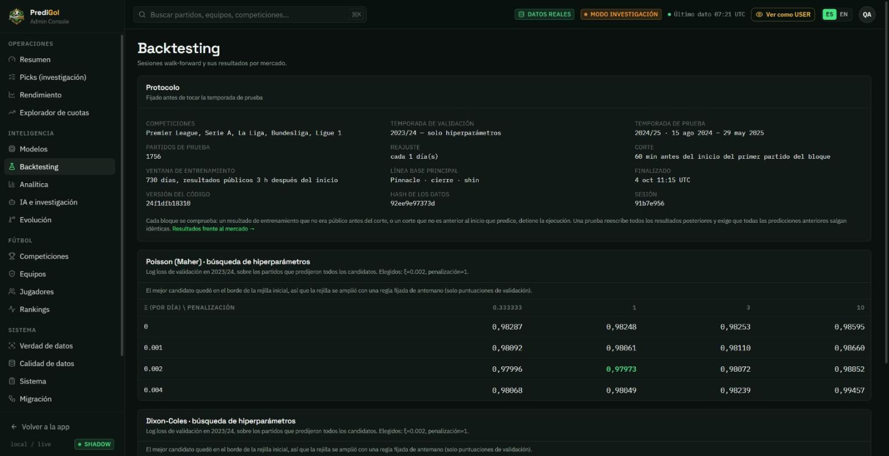

**Qué estoy viendo.** El **protocolo** fijado antes de mirar la temporada de prueba: competiciones, temporada de
validación (solo para elegir hiperparámetros), temporada de prueba (2024/25, 1.756 partidos), reajuste diario, corte
60 min antes del primer partido del bloque, ventana de 730 días, línea base Pinnacle, versión del código y hash de los
datos; después la búsqueda de hiperparámetros de cada modelo.

**Para qué sirve.** Comprobar que la comparación con el mercado fue limpia (sin mirar el futuro).

**Cómo se hace un backtest (en sencillo):**
`Entrenamiento → Validación → Corte temporal → Predicción → Precio disponible → Resultado → Comparación con el mercado`.
Cada día de la temporada de prueba el modelo se reentrena con lo que se sabía hasta el corte, predice los partidos de
ese día, y su probabilidad se compara con lo que pasó **y** con la del mercado sin margen, en los mismos partidos.

**Qué números vigilar.** Que el mejor hiperparámetro no quede en el borde de la rejilla (si pasa, la rejilla se amplía
con una regla fijada de antemano, como aquí); el hash de los datos y la versión del código (trazabilidad).

**Qué requiere acción.** Nada: es una página de registro. Un backtest nuevo con `--apply` solo puede guardarse si hay un
dataset MODEL_READY (hoy no lo hay, por decisión pendiente tuya).

**Qué NO interpretar mal.** Un backtest no es una promesa de beneficio ni un historial real; con pocas muestras no
prueba nada; y un ROI simulado alto con un log loss peor que el mercado es suerte o sobreajuste. Lo detallado está en
`PICKS_DECISION_2026-10-05.md` (§2: walk-forward, leakage, calibración, Brier, log loss, Pinnacle, ROI, VE, intervalos).

## Analítica

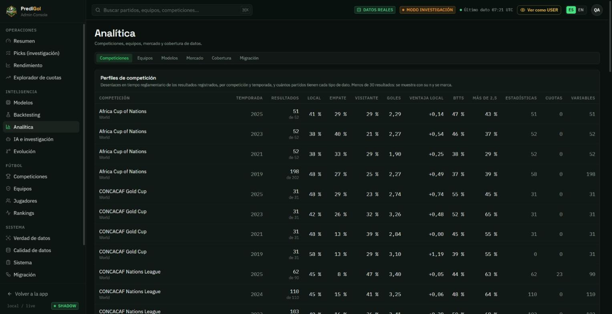

**Qué estoy viendo.** Perfiles de cada competición y temporada (resultados, % local/empate/visitante, goles, ventaja de
local, BTTS, más de 2,5) y cuántos partidos tienen estadísticas, cuotas y variables; otras pestañas: equipos, modelos,
mercado, cobertura y migración.

**Para qué sirve.** Detectar competiciones raras (pocos datos, sin cuotas) antes de modelarlas.

**Qué NO interpretar mal.** "Resultados 51 de 52" significa que falta uno: mira Verdad de datos antes de suponer un error.

## IA e investigación

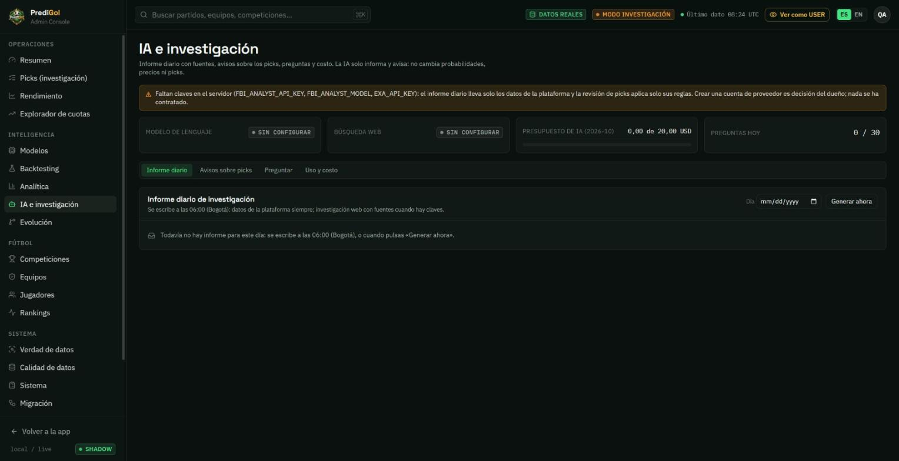

**Qué estoy viendo.** El informe diario de investigación, los avisos sobre picks, las preguntas y el uso/costo. Hoy
**sin modelo de lenguaje ni búsqueda web configurados** (faltan claves en el servidor; contratar un proveedor es tu
decisión). Presupuesto del mes: 0,00 de 20,00 USD; preguntas: 0 de 30 al día.

**Para qué sirve.** Cuando se configure, la IA **solo informa y avisa**: no cambia probabilidades, precios ni picks.

**Qué NO interpretar mal.** Sin claves, el informe diario no es "IA": son los datos de la plataforma con reglas. Costes y
arquitectura propuesta en `AI_COSTS_AND_ARCHITECTURE.md` (estado: DEFERRED).

## Evolución

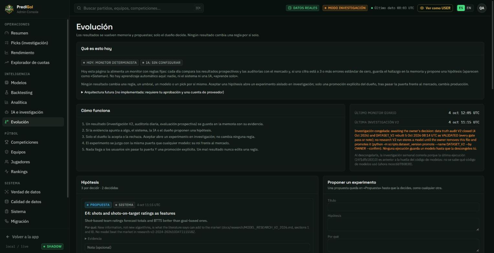

**Qué estoy viendo.** El bucle de evolución: *Qué es esto hoy* (**monitor determinista**, IA sin configurar), *Cómo
funciona* (5 pasos), el último monitor diario y la última investigación V2, el **estado congelado** de la
investigación con su motivo, las hipótesis (propuestas por el Sistema, la IA o tú) y un formulario para proponer un
experimento.

**Para qué sirve.** Llevar la memoria de lo que se ha aprendido y decidir qué se investiga después.

**Cómo funciona (de verdad).** Cada día un monitor con reglas fijas compara los resultados prospectivos y las
auditorías con el mercado; si una cifra está a ≥ 3 errores estándar de cero, la guarda en la memoria y propone una
hipótesis. **Nadie aprende solo**: ni el sistema ni una IA. Aceptar una hipótesis abre un experimento aislado; solo
una promoción explícita tuya, después de pasar la puerta frente al mercado, cambia producción.

**Flujo futuro (no implementado, necesita tu aprobación y una cuenta de proveedor):**
`OBSERVAR → MEDIR → IA INVESTIGA → IA PROPONE → EXPERIMENTO AISLADO → BACKTEST → PROSPECTIVE SHADOW → COMPARACIÓN CON
CHAMPION → PROPUESTA → APROBACIÓN HUMANA → PROMOCIÓN`. Nunca: "mal resultado → la IA cambia producción".

**Qué es normal hoy.** "Investigación congelada": DATASET_V2 está VALIDATED y espera tu decisión. La línea "Al
descongelarla, correría porque…" explica qué la haría correr (aquí: la última ejecución es anterior a la huella del
código de modelos).

**Qué requiere acción (tuya).** Decidir si promueves DATASET_V2 (retirar `data/research.frozen` y
`python -m scripts.dataset_version promote --name DATASET_V2 --by TU_NOMBRE --confirm`); aceptar o rechazar hipótesis.

**Qué NO interpretar mal.** "Sistema" en una hipótesis significa "el monitor de reglas", no una IA. Un despliegue que no
toca los modelos ya no hace "debida" la investigación (corregido hoy: se compara el código de los modelos, no el commit).

## Competiciones

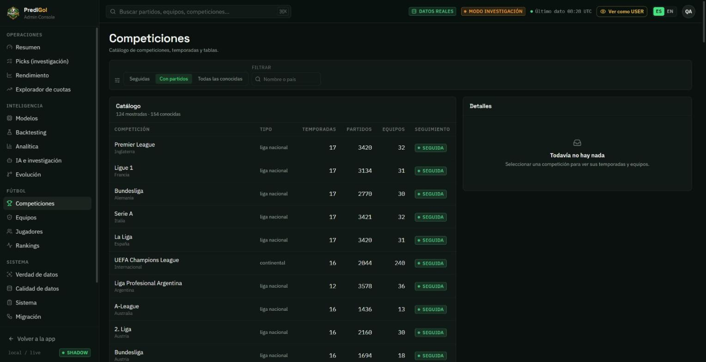

**Qué estoy viendo.** Las 154 competiciones conocidas (124 seguidas), con país, tipo, temporadas, partidos y equipos;
el detalle muestra fases, tablas y si hay temporada actual.

**Qué NO interpretar mal.** Dos ligas con el mismo nombre (Bundesliga de Alemania y de Austria) son ligas distintas: el
país y el id del proveedor las separan.

## Equipos

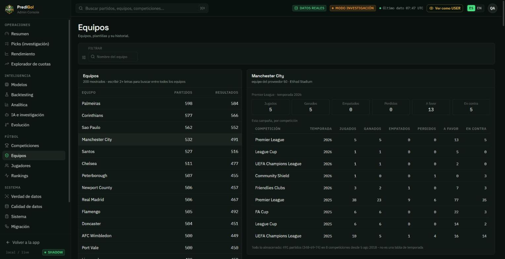

**Qué estoy viendo.** Los equipos con más partidos primero (escribe 2 letras para buscar entre todos) y el detalle:
balance de la temporada, esta campaña por competición y todo lo almacenado (por ejemplo Manchester City: 491 partidos
en 8 competiciones desde agosto de 2018).

**Qué NO interpretar mal.** "Todo lo almacenado" **no es una tabla de temporada**: suma competiciones y años.

## Jugadores

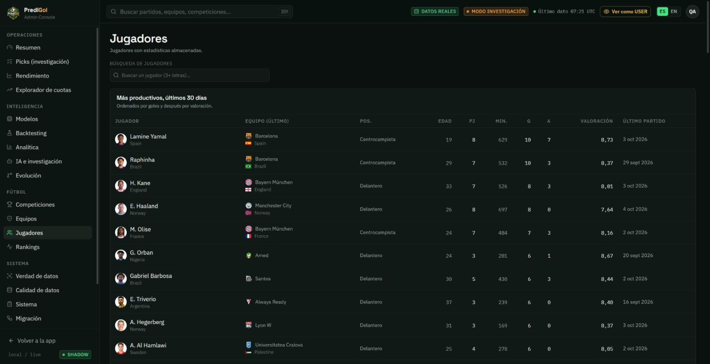

**Qué estoy viendo.** Jugadores con club actual, selección, posición (en tu idioma), estadísticas por partido y por
temporada, lesiones y trayectoria.

**Qué NO interpretar mal.** Si nuestras apariciones no coinciden con el agregado del proveedor, casi siempre es el
proveedor actualizando tarde (Verdad de datos lo registra como PROVIDER_STALE).

## Rankings

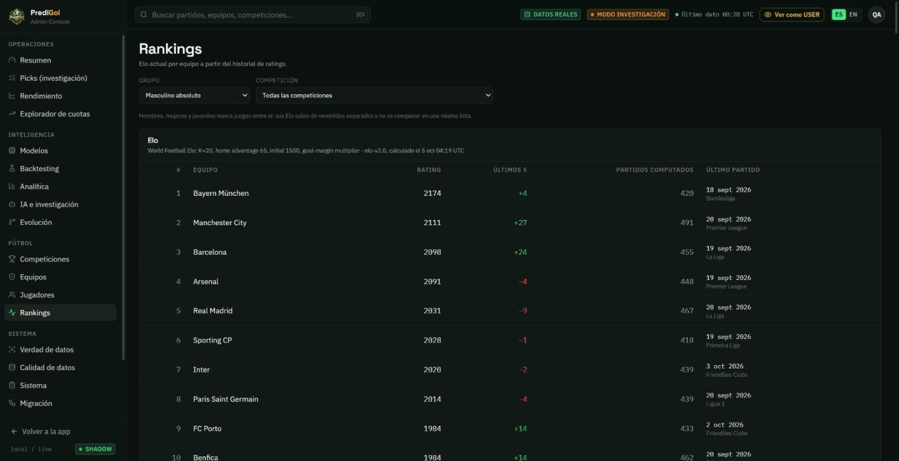

**Qué estoy viendo.** Ratings Elo de equipos (recalculados cada 6 h desde todos los resultados), por **grupo**
(masculino absoluto por defecto, femenino, juveniles o todos) y por la competición de su último partido.

**Qué NO interpretar mal.** Un Elo alto no es una probabilidad de ganar: es una medida relativa entre equipos que han
jugado entre sí (directa o indirectamente). Hombres, mujeres y juveniles nunca se enfrentan: hasta hoy aparecían en una
sola lista (Barcelona W por encima del Manchester City); ahora cada grupo va por separado y "Todos" lo advierte.

---

## Verdad de datos

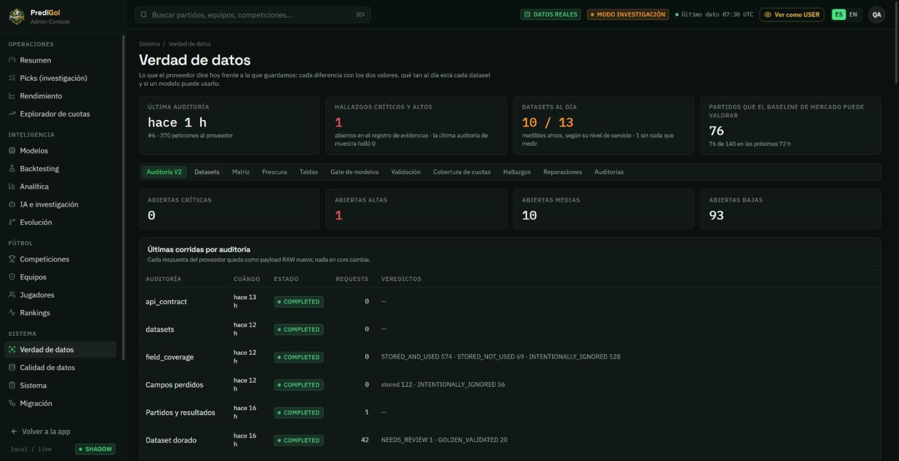
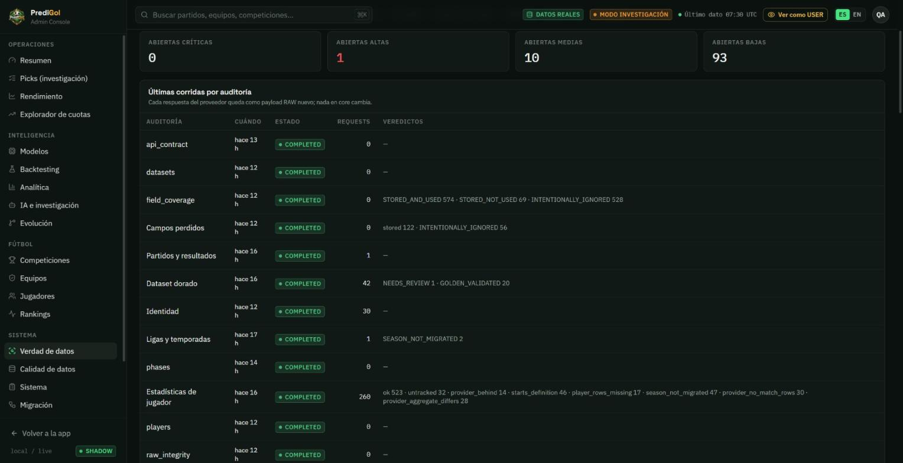
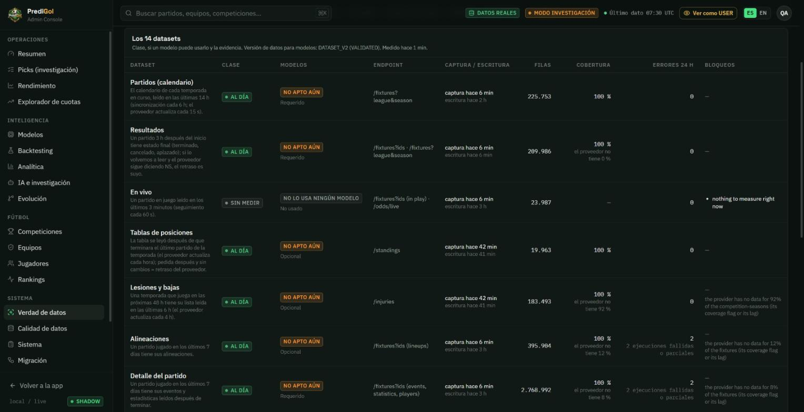

**Qué estoy viendo.** Lo que el proveedor dice hoy frente a lo que guardamos: la última auditoría (muestra con
peticiones reales al proveedor), los **hallazgos críticos y altos**, los datasets al día, las corridas por auditoría
(contrato de la API, cobertura de campos, dataset dorado, identidad, tablas, estadísticas…), el **registro de
evidencias E-XXX** (quién está mal, por qué, cómo se arregla; nada se borra, se marca) y el registro de los **14
datasets** con su clase, si un modelo puede usarlo, frescura, filas, cobertura, errores y bloqueos.

**Para qué sirve.** Saber si los datos son verdad antes de creer cualquier número del resto de la consola.

**Qué números vigilar.**

| Indicador | Hoy (5 oct) | Lectura |
|---|---|---|
| Última auditoría (#6, 06:30 UTC, 370 peticiones) | 0 críticos, 0 altos, 103 medios, 188 bajos | ninguna diferencia grave entre el proveedor y nosotros |
| Registro de evidencias abiertas | 1 alta (**del proveedor**: tabla de Ligue 1 2025/26 frente a la decisión de la LFP) | aceptada como hecho del proveedor |
| En seguimiento | 3 altas propias: 3 payloads RAW dañados el 4 oct a las 02:57 (40 filas) | causa corregida (fsync antes de renombrar); el RAW no se repara nunca |
| DATASET_V2 | VALIDATED (reconstruido 5 oct 08:14 UTC); 16 temporadas MODEL_READY | promoción pendiente de tu decisión |

**Estados de un dataset.** AL DÍA (FRESH), ATRASADO (STALE), INCOMPLETO, INVÁLIDO, SIN MEDIR (UNKNOWN); y para modelos:
APTO (MODEL_READY) o NO APTO AÚN. "No apto aún" hoy significa "esperando la promoción del dueño", no "dato malo".

**Qué requiere acción.** Una entrada crítica o alta **propia** (responsable PREDIGOL) abierta; un dataset requerido por
los modelos que pase a ATRASADO.

**Qué NO interpretar mal.** "El proveedor no tiene el 92 % de las lesiones" es una limitación del proveedor (su
bandera de cobertura), no un fallo nuestro. Los textos de causa y arreglo del registro se guardaron en inglés.

## Calidad de datos

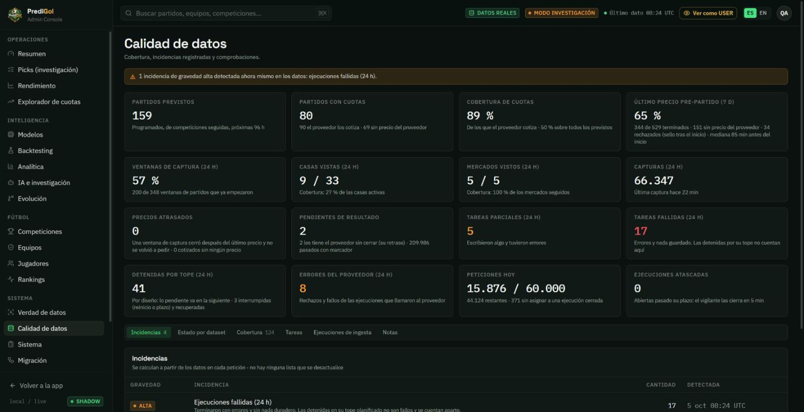
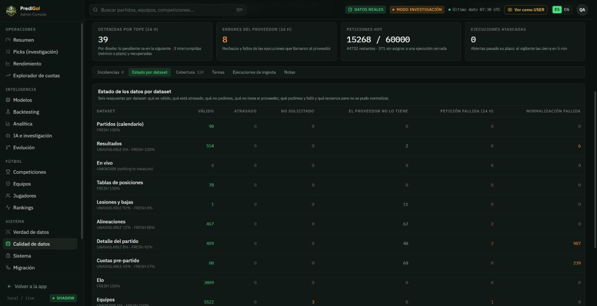

**Qué estoy viendo.** Tarjetas de cobertura y de salud de las tareas (24 h), y pestañas: *Incidencias* (calculadas en
cada petición), *Estado por dataset*, *Cobertura* por competición, *Tareas*, *Ejecuciones de ingesta* y *Notas*.

**La pestaña "Estado por dataset"** separa, para cada dataset, por qué falta algo:

| Estado | Significa | ¿Hay que hacer algo? |
|---|---|---|
| EL PROVEEDOR NO LO TIENE | su bandera de cobertura dice que no, o lo pedimos y no lo tenía | no |
| NO LO PEDIMOS | fuera de alcance (liga no seguida, sin cuotas) | solo si se amplía el alcance |
| LO PEDIMOS Y FALLÓ | error de red o del proveedor | si se repite |
| LO TENEMOS PERO LA NORMALIZACIÓN FALLÓ | el RAW está, la fila no | **sí** (es nuestro) |
| LO TENEMOS PERO ESTÁ ATRASADO | más viejo que su nivel de servicio | si persiste |
| VÁLIDO | todo bien | no |

**Qué números vigilar.** *Ejecuciones atascadas* (0), *Tareas fallidas (24 h)*, *Errores del proveedor (24 h)*,
*Precios atrasados* (0), *Cobertura de cuotas* (de lo que el proveedor cotiza).

**Qué es normal hoy.** *Tareas fallidas 17*: son del 4 oct (10:18–11:11, un fallo de restricción del pipeline de picks
ya corregido) y salen de la ventana de 24 h a las 11:11 UTC del 5 oct. *Detenidas por tope 41*: por diseño (la tarea
de referencia gasta 300 peticiones por ejecución y sigue en la siguiente). *Errores del proveedor 8*: un límite por
minuto (arreglado), una petición inválida de una auditoría y un corte de conexión. *Cobertura de cuotas 89 %* de lo que
el proveedor cotiza (50 % de todos los partidos previstos: muchos no tienen cuotas en el proveedor). *Ventanas de
captura 57 %*: el resto son de partidos sin cuotas del proveedor.

**Qué requiere acción.** *Ejecuciones atascadas* > 0 más de 10 min (el vigilante no corre); *Tareas fallidas* que
siguen apareciendo; *Precios atrasados* > 0 en partidos cotizados.

**Qué NO interpretar mal.** "Detenidas por tope" no son fallos. "Pendientes de resultado: 2 los tiene el proveedor sin
cerrar" no es nuestro retraso.

## Sistema

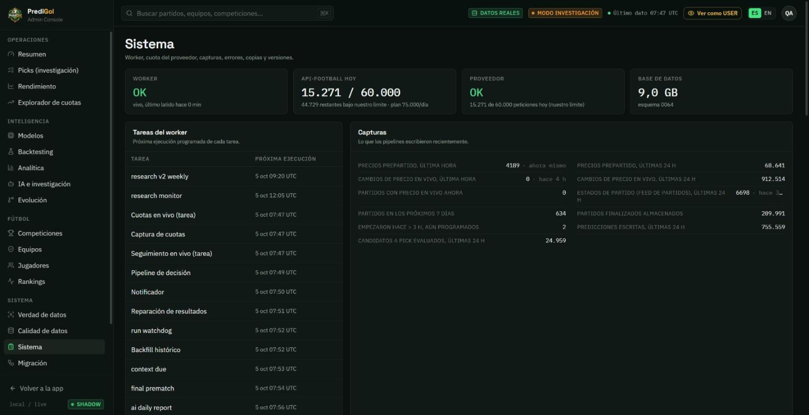
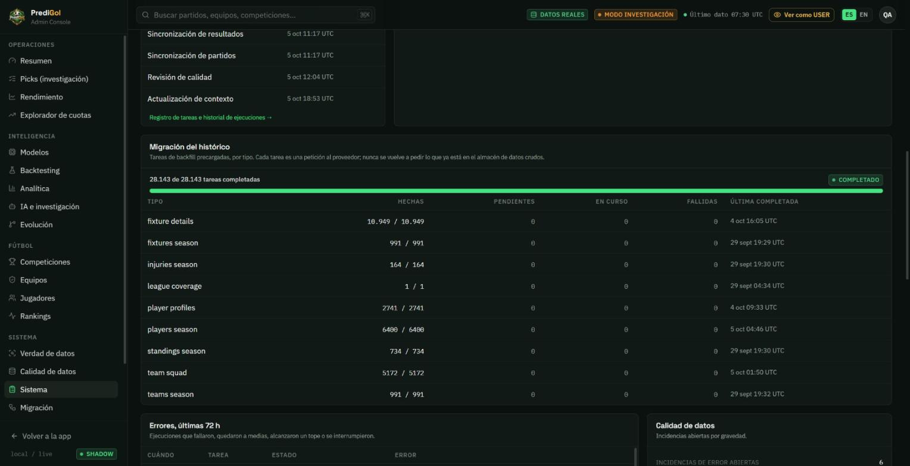
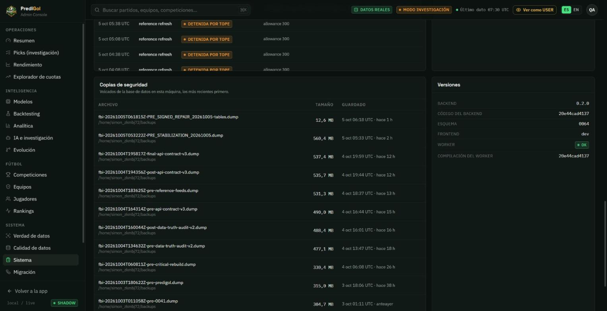

**Qué estoy viendo.** Worker, **API-Football hoy** (peticiones / presupuesto interno, restantes y plan), proveedor,
tamaño de la base, la próxima ejecución de cada tarea del worker, las capturas recientes, el progreso de la migración
del histórico, los **errores de las últimas 72 h**, las **copias de seguridad** de la máquina y las **versiones**
(backend, código, esquema, compilación del worker).

**Qué números vigilar.** Que *Código del backend* y *Compilación del worker* coincidan (si no, el worker corre código
viejo: reinícialo); que haya una copia de las últimas 24 h; errores que no sean "detenida por tope".

**Qué es normal.** Muchas "DETENIDA POR TOPE" de la tarea *Datos de referencia* (primer llenado: ~23.500 peticiones,
300 por ejecución cada 30 min; después ~3.500 al día).

**Qué requiere acción.** Una tarea que falla una y otra vez; ninguna copia en 24 h; la base creciendo más de lo
previsto (`STORAGE_FORECAST.md`).

## Migración

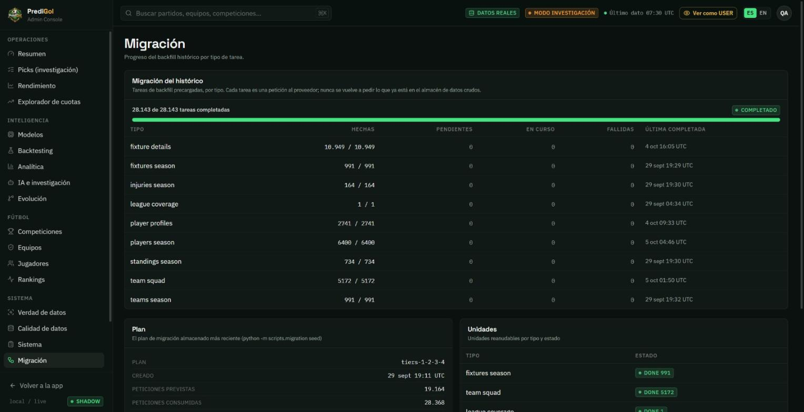

**Qué estoy viendo.** El backfill del histórico por tipo de tarea: **28.143 de 28.143 completadas** (COMPLETADO); el
plan (`tiers-1-2-3-4`, 19.164 peticiones previstas, 28.368 consumidas) y las unidades reanudables.

**Qué NO interpretar mal.** Cada tarea es una petición; nada que ya esté en RAW se vuelve a pedir.

## Usuarios

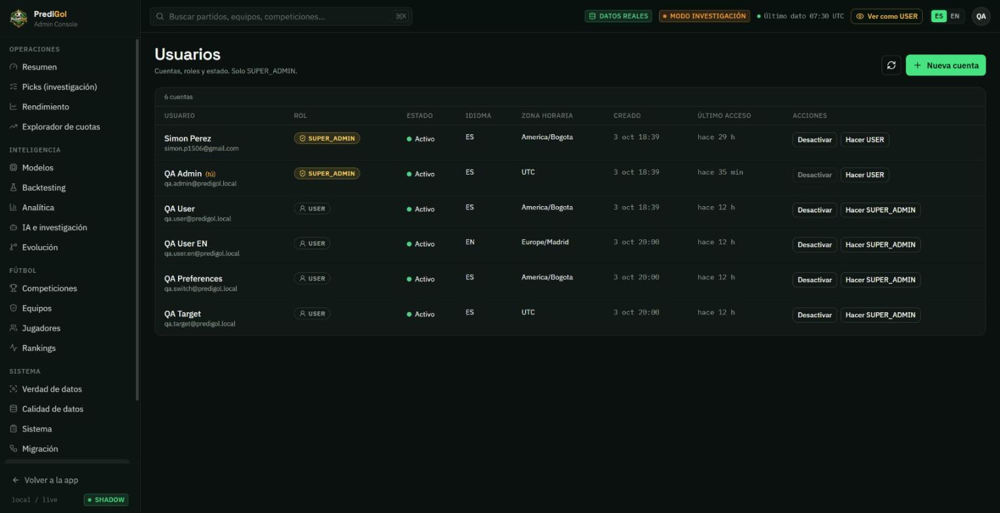

**Qué estoy viendo.** Las cuentas, su rol (SUPER_ADMIN o USER), estado, idioma, zona horaria y último acceso; crear
cuentas, desactivarlas y cambiar el rol. Solo SUPER_ADMIN.

**Qué requiere acción.** Una cuenta SUPER_ADMIN que no reconozcas. Las cuentas *QA* son de pruebas locales; desactívalas
antes de cualquier despliegue público.

## Auditoría

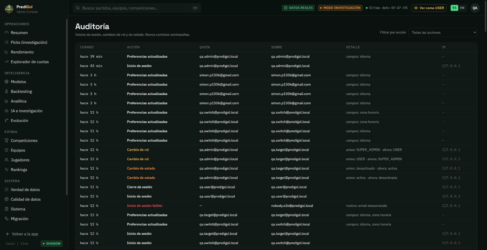

**Qué estoy viendo.** Inicios de sesión (también los fallidos), cambios de rol, de estado y de preferencias, con quién,
sobre quién, detalle e IP. **Nunca contiene contraseñas.**

**Qué requiere acción.** Inicios de sesión fallidos repetidos sobre una cuenta real; cambios de rol que no hiciste.

## Ajustes

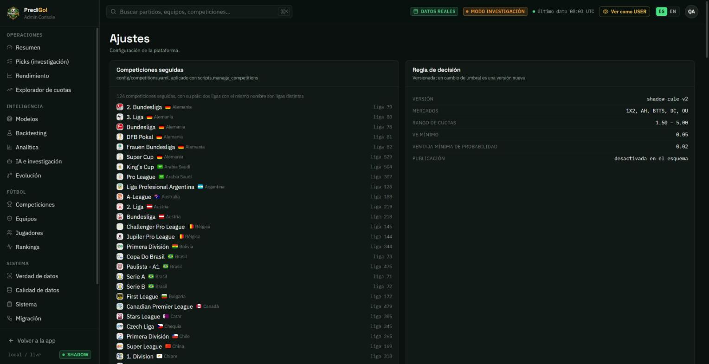

**Qué estoy viendo.** Las 124 competiciones seguidas (con su país), la **regla de decisión** versionada y la
configuración del AI Analyst y de las notificaciones. Se cambian en el servidor (`config/competitions.yaml` +
`scripts.manage_competitions`), nunca desde el navegador.

**Qué NO interpretar mal.** "Publicación: desactivada en el esquema" significa que ni siquiera un error de código podría
publicar un pick: la base de datos lo impide.

---

## La cuota de API-Football

* **Plan Ultra**: 75.000 peticiones/día y 450/min. **Presupuesto interno**: 60.000/día (siempre por debajo del plan),
  contado en la base de datos antes de cada petición; el límite por minuto también se comparte entre procesos.
* **Hoy (5 oct, 08:20 UTC)**: 15.576 — sobre todo cargas únicas: migración 5.787 (ya terminada), primer llenado de la
  referencia 4.200, auditorías 1.110.
* **Régimen estable**: ~6.000 peticiones en un día normal y ~8.150 en un día P95 (≈ 14 % del presupuesto interno).
  Máximo histórico 29.418 (4 oct, migración + captura antes del arreglo).
* **+50 ligas**: ~11.430 en un día P95 — cabe de sobra (ver `API_CAPACITY.md`).
* **Renovación**: la suscripción vence el **29 oct 2026**. Sin renovación, la captura se para. Decisión tuya.
* **Seguridad**: la clave de la API se vio en capturas de pantalla del panel del proveedor. `SECURITY_ACTION: rotación
  recomendada posteriormente` (no se ha rotado: requiere tu autorización y actualizar el servidor a la vez).

## Glosario

| Término | Significado |
|---|---|
| Shadow | se calcula y se mide, pero nadie lo ve y no se apuesta |
| Champion / Challenger | el mejor pronóstico vigente (hoy el mercado) / un modelo que lo batiría en su backtest |
| De-vig (sin margen) | quitar el margen de la casa a las probabilidades implícitas (Shin, proporcional, *power*) |
| Log loss / Brier | errores de una probabilidad frente a lo que pasó; menor es mejor; siempre en los mismos partidos |
| Calibración / ECE | si "60 %" ocurre el 60 % de las veces / cuánto se aleja |
| VE (valor esperado) | cuota × probabilidad − 1; solo vale si la probabilidad es buena |
| CLV | si el precio tomado era mejor que el de cierre; medirlo contra el cierre **sin margen** de una casa afilada |
| Walk-forward | reentrenar día a día solo con lo que se sabía |
| Leakage | usar algo que no se sabía al predecir |
| MODEL_READY | dato apto para entrenar y juzgar modelos; para un dataset entero, lo decide el dueño |
| RAW | la respuesta tal cual del proveedor, comprimida y con su huella; evidencia que nunca se modifica |

## Qué hacer si…

| Síntoma | Primero | Después |
|---|---|---|
| Worker DOWN o sin latido | Sistema → próximas ejecuciones y errores | `bash ~/.fbi/restart.sh worker` en la máquina |
| Proveedor DEGRADED | Calidad de datos → errores del proveedor | si es límite por minuto, esperar; si es la cuota diaria, nada se pide hasta las 00:00 UTC |
| Base de datos creciendo de más | `python -m scripts.storage_forecast` | revisar la tabla que más crece |
| Hallazgo crítico propio en Verdad de datos | leer la entrada E-XXX (causa y arreglo) | no tocar datos a mano: toda reparación deja rastro en `audit.data_repairs` |
| Un modelo aparece como CHALLENGER | Modelos + Backtesting + Rendimiento | promoverlo es decisión tuya, con la puerta frente al mercado |
| Quieres desplegar | `DEPLOYMENT_COSTS.md` | renovar API, rotar clave, retención, revisión legal |
